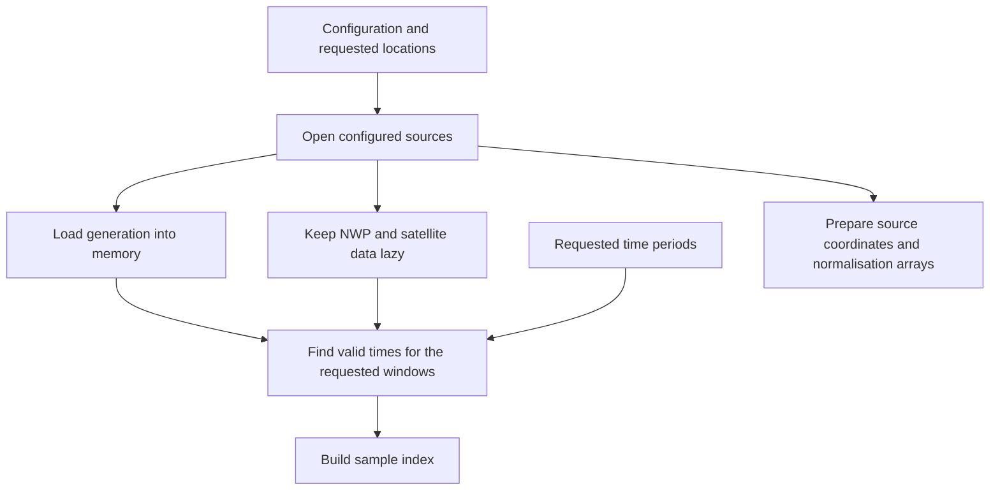
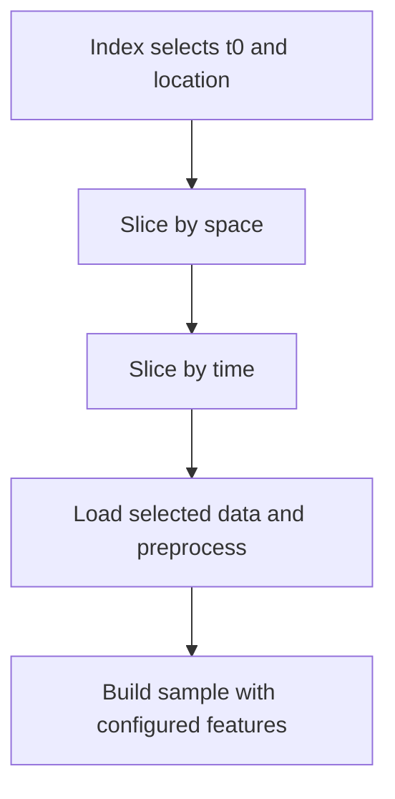
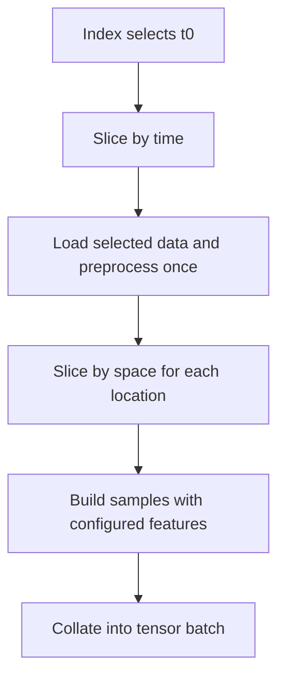

# PVNet datasets

This module provides PyTorch datasets that construct input and target samples for PVNet
training and inference from configured generation, NWP and satellite sources.

## Sample construction

Initialisation reads the configuration and locations, opens the configured sources, and builds
an index of valid samples. Generation data is loaded into memory at this stage; NWP and satellite
data are loaded when samples are retrieved. Source coordinates and normalisation arrays are
prepared once for reuse.

- `PVNetDataset`: each index selects one forecast reference time (`t0`) and location and
  returns a dictionary of NumPy arrays and metadata.
- `PVNetConcurrentDataset`: each index selects one `t0` that is valid at every requested
  location and returns a batch of tensors containing all locations.

The retrieval paths differ so that concurrent samples share loading and preprocessing:

### PVNetDataset

### PVNetConcurrentDataset

### Shared processing and availability

Preprocessing includes NWP accumulation differencing, normalisation, input dropout and NaN
filling. Sample construction adds the configured solar position and time features.

Every requested location must have valid samples. Use `sampling_grid.exclude_location_ids` to
exclude locations intentionally. For concurrent samples, times that are unavailable at any
requested location are excluded from the index.

## Time conventions

`t0` is the forecast reference time. Each source's `interval_start_minutes` and
`interval_end_minutes` define its time window relative to `t0`.

Generation and satellite windows include both endpoints. For example, a generation input
window from `-60` to `0` at a 30-minute resolution contains values at `t0 - 60 minutes`,
`t0 - 30 minutes` and `t0`. Setting `interval_end_minutes=0` therefore includes the value at
`t0` before any configured dropout is applied.

Generation input and target windows are configured separately. A target window starting at
`0` includes `t0`; to start with the next time step, set its start offset to the generation
time resolution.

NWP windows refer to forecast valid times. Their bounds are rounded up to the configured NWP
time resolution. Sampling selects the most recent eligible NWP initialisation, accounting for
the requested window and any configured dropout that simulates an older available forecast.

The dataset's `time_periods` argument restricts which **`t0` values** are sampled. These periods
include their start and exclude their end, independently of the source-window conventions above.

## DataLoader workers and randomness

When using multiple `DataLoader` workers, set `multiprocessing_context="forkserver"`.
The `fork` context is unsupported for TensorStore-backed datasets.

Dropout choices use NumPy's global random state (`np.random`). Repeated access to the same
sample index can therefore choose different dropout; the choice depends on the random state
at the time of sampling.

PyTorch seeds NumPy in each `DataLoader` worker. Seed PyTorch before creating the loader's
iterator, or supply a seeded `torch.Generator` to the loader, to control its worker seeds.
When accessing the dataset directly or using `num_workers=0`, seed `np.random` yourself.
Reproducing dropout choices also depends on keeping the worker setup and sampling order the same.
